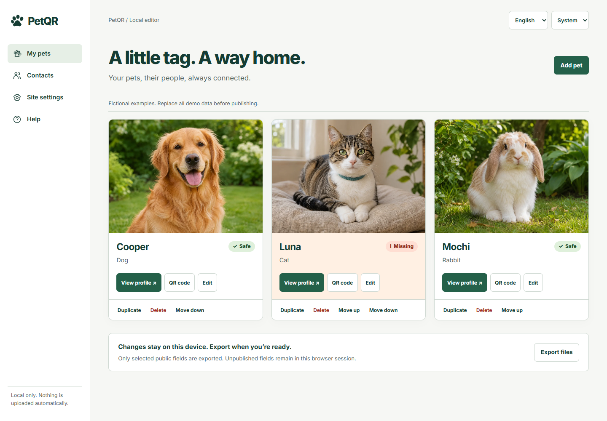

# PetQR

A little tag. A way home.

PetQR gives every pet a permanent identification page and a printable QR code. Manage dogs, cats, rabbits, birds or any other companions in one independent repository. Your copy includes the entire application: no PetQR account, server, database, mandatory API key, subscription or central domain. Optional direct saving uses your own short-lived, repository-scoped GitHub access key.

**English · [Español](docs/QUICKSTART.es.md) · [Català](docs/QUICKSTART.ca.md)**



[See a mobile emergency profile in Catalan](docs/screenshots/mobile.png).

## Edit → Save and publish, entirely on GitHub Pages

The editor can now update your repository directly, including photos, without downloading a ZIP or running a backend.

1. Open `/editor/` and click **Connect GitHub**. The repository is detected from that copy's own GitHub Actions build.
2. Click **Create a limited access key in GitHub**. GitHub pre-fills the owner, a seven-day expiration and **Contents: Read and write**. In **Repository access**, select **Only select repositories** and choose **only your PetQR repository**. Do not grant Workflows, Administration or all-repository access.
3. Generate the fine-grained key, paste it into the editor's password field and confirm the repository restriction. Do not paste it into a pet field, source file or chat. Classic/broad keys are rejected by the editor.
4. Edit your pets, click **Save and publish**, review the public-data notice and press **Publish changes**. Data and referenced photos are saved together in one commit. The editor reports **Saved in GitHub**, then **Published** once Pages serves the new version.

The key stays only in this tab's memory. The connection expires after 30 minutes and is forgotten on disconnect, navigation or reload. Reconnecting may reuse the same unexpired key; GitHub's key expiration and the editor's shorter connection lifetime are separate. Closing the tab does not revoke the key in GitHub; use **Manage or revoke keys** for that. PetQR does not store it in local drafts, browser storage, exported ZIPs or repository files.

GitHub enforces repository permissions. The Contents permission grants write access to that repository's content, not a GitHub-enforced folder restriction; protect the key and use only a trusted copy of the editor. The editor itself allows writes only to the four public `data/*.json` files and referenced `assets/pets/` images. It checks source-file hashes, preserves unrelated code, never force-pushes, and stops if newer remote data or a concurrent update is detected. Save/export your draft before reloading after a conflict.

No OAuth login server, paid service or maintainer-controlled domain is involved. This is a **fine-grained access-key connection**, not an automatic GitHub sign-in. The public profiles and ZIP workflow remain fully functional without it. See [direct saving and security](docs/GITHUB_SAVE.md).

## Start on GitHub — no coding needed

1. The maintainer first enables **Settings → General → Template repository** for this repository. As a user, click **Use this template → Create a new repository**. Choose **your own account**, any repository name, and **Public** for free GitHub Pages hosting. If the source is not yet marked as a template, download it and upload these files, including `.github/workflows/pages.yml`, to a new repository.
2. In **your new repository**, open **Settings → Pages → Build and deployment → Source**, and select **GitHub Actions**. Enable Actions if your organization restricts them.
3. Open **Actions → Validate, test & deploy PetQR → Run workflow** on your default branch. The first run publishes clearly labeled fictional examples. Wait for the green deployment, then follow its Pages URL. No personal access token or extra secret is needed.
4. Visit `<your Pages URL>/editor/`. In **Site settings**, verify the public site URL, including the repository path. The workflow fills it from your repository's Pages metadata; an explicit custom URL overrides it.
5. Replace the example pets using **Edit**, or delete them and **Add pet**. Add your contacts in **Contacts**, confirm publication, and assign them to each pet. Set the preferred order for emergency contacts. Turn off **Demo data notice** after replacing all fictional data.
6. **Preview profile**, then connect GitHub and use **Save and publish** as described above. Alternatively, choose **Export files → Confirm publication · ZIP**. Extract the download, replace the repository's **entire `data/` folder**, and upload/merge the exported photos into `assets/pets/`. Keep the existing application source and workflow. GitHub's **Add file → Upload files** supports uploading a folder's contents. Confirm the exact paths below without an extra ZIP folder prefix, then commit to your default branch.
7. Wait for Actions to finish. Open each pet's **View profile** and confirm the contacts, photo and warnings on your phone. Local editor changes update the website only after publishing and deployment.
8. In the editor, open **QR code** for each pet. Download SVG for printing/engraving or PNG for other tools. **Test destination** opens the final deployed URL; also scan the exported/printed QR with more than one phone. Keep the URL and stable pet ID unchanged after printing.

The project works with `https://USERNAME.github.io/REPOSITORY/`, `https://USERNAME.github.io/` and custom domains. Those are URL patterns, not dependencies on a particular account. A copy continues to work if its original repository disappears.

## What is included

- Any number of profiles, each built to a real `p/PET_ID/index.html`, with emergency contacts available even without JavaScript.
- A local visual dashboard: add, edit, duplicate, reorder and delete; safe/missing/found/custom status; shared contacts and pet-specific overrides.
- Optional **Save and publish** to your own GitHub repository with atomic data/photo commits, conflict checks and deployment status; credentials stay in tab memory only.
- Basic/advanced forms, over 100 optional animal fields, custom sections/links/warnings, multilingual free text, explicit sensitive-field publication and filtered ZIP export/import.
- Local photo crop, rotation, pan, compression to at most 300 KB, WebP/JPEG conversion, alt text, featured photo and ordering. No remote image service.
- Bundled QR generator: SVG/PNG, resolution, colors with enforced contrast, error correction, quiet zone, labels, destination check, millimeter tag designer and print layout.
- English, Spanish and Catalan; browser preference, manual selection, fallback language; system/light/dark modes, keyboard focus, reduced motion and responsive layouts.
- Optional finder location sharing: explicit permission, a WhatsApp draft, and a separate manual send. No PetQR server receives location.
- Strict TypeScript and runtime schema validation, automated unit/build/browser/accessibility tests, MIT license and GitHub Pages deployment.

## Public means public

**Only put information you intend to publish in this repository.** Every committed source file, photo, JSON file and generated asset can be read. Health records, contact details and identification numbers may be sensitive. An unpublished editor field stays in the current browser session and is excluded from the public ZIP; saving a local draft is optional and uses this browser's local storage database. Anyone with access to the browser/device may access that draft.

The build **rejects** unpublished/unconfirmed configuration in the repository; it does not turn a public repository into a private vault. Medical fields and identification numbers require explicit publication consent. Uploaded photographs are re-encoded locally to remove the original EXIF metadata. Never upload original personal documents, precise home addresses, secrets or local draft files.

Disabling the owner index removes the overview links, but the public editor configuration still contains all **published** profiles. `noindex`, `robots.txt` and hard-to-guess URLs are not privacy controls. Deleting data from a later deployment does not remove Git history, caches or other people's copies. See the [privacy guide](docs/PRIVACY.md).

## Everyday tasks

**Add several pets:** Add pet creates a new random, stable ID. Duplicate copies information but creates a different ID/QR. The dashboard order is saved in `data/pets.json`.

**Mark missing or found:** Edit → Emergency message → Status. Add urgent instructions, then Save and publish (or export/upload/deploy). The public URL and QR stay unchanged.

**More details:** Switch to Advanced. Open a category, select an optional field and Add field, or add a custom section. Check Publish for each intended public field. Choose Warning to keep urgent text visible in emergency view. Medical/identification publication asks for consent. Use Edit translation to enter translated values without changing the interface language.

**Photos:** Edit → Photos → Add photo. Crop, pan/zoom and rotate before Use photo. Add alt text; choose Make featured or reorder. Upload the exported image files along with the configuration. Photo removal updates the public page; manually remove unused photos from the repository if desired, remembering history can retain them.

Photos are automatically converted to WebP (JPEG fallback), at most 1200 px / 300 KB. There is no fixed source-file size limit: input decoding depends on the browser/device. Common JPEG, PNG, WebP, GIF, AVIF and BMP files are supported by current browsers; HEIC/HEIF requires native browser support. Animated images become a still photo. Unsupported formats require conversion or another browser. The original photo never leaves the device.

**Telegram is optional:** under More contact methods, enter `username`, `@username` or a public `https://t.me/username` link, or leave blank. PetQR does not require a Telegram account, bot or API. Incomplete contact methods show a preview warning without blocking photo editing; correct them before exporting.

**Design:** Edit → Appearance. Accent colors are decorative so they cannot reduce contact/warning contrast. Choose a background and icon. Site settings controls the public index and attribution. Each profile's indexing starts disabled.

**Keep a draft:** Site settings → Save draft on this device. It is never automatically uploaded. Restore or forget it explicitly. Clearing browser data may erase it. Public ZIPs are portable backups of **published** information only.

## Local development

Install Node.js **22.12+** (24 LTS used in CI), then:

```sh
npm ci
npm run dev
```

Open the printed local URL, then `/editor/`. After changing source/configuration files, rebuild/restart the dev command. Browser editor changes have their own live preview. Public QR creation intentionally refuses localhost URLs.

```sh
npm run validate
npm run build
npm test
npx playwright install chromium
npm run test:e2e
npm run preview
```

Build before running tests that inspect generated routes. Static checks adapt to your real configuration; browser tests separately build fictional fixtures in `.test-site/` and never overwrite your production `dist/`. You can delete every demo pet without breaking deployment tests. Browser tests use Chrome on Windows and Playwright Chromium elsewhere. Set `PETQR_BROWSER=msedge` (or an installed Playwright channel) to override, or `PETQR_BROWSER=chromium` to use downloaded Chromium. The test server covers real requests under `/test-repo/` as well as the root. Screenshots/test artifacts go to the operating system's temporary folder unless `PETQR_SCREENSHOT_DIR` is set.

## Files you upload from the editor

```text
data/
  version.json      # schema version, currently 1
  site.json         # title, language, final URL, index and attribution
  contacts.json     # confirmed public shared contacts
  pets.json         # ordered profiles and selected public fields
assets/pets/
  <photo>.webp      # or locally hosted PNG/JPEG
```

Replacing `data/pets.json` removes deleted pets on the next clean build; there are no per-pet source files to delete. **Deleting a profile invalidates existing physical tags.** Never reuse another animal's old ID. Stable QR destinations depend on keeping the domain, repository path and pet ID. Renaming a repository/domain requires preserving redirects on the old host or replacing tags.

## Deployment and portability

The workflow validates files and images, builds every HTML route, runs unit/browser/accessibility checks and deploys `dist/` with official Pages actions. Deploy permissions are restricted to the deployment job. PRs are checked without deploying. Any default branch name works. GitHub Pages itself is an external hosting dependency; its policies, availability and domain are outside PetQR's control.

To migrate, `npm ci && npm run build`, then upload **all contents of `dist/`** to any static web host with directory index support. Configure `data/site.json.publicUrl` before building if your final address changes. No runtime CDN, fonts, scripts, remote configuration or mandatory third-party requests are used. Optional contact/map links are opened only through finder interaction. See the [deployment guide](docs/DEPLOYMENT.md).

## Documentation

- [User guide](docs/USER_GUIDE.md)
- [Configuration reference](docs/CONFIGURATION.md)
- [Deployment guide](docs/DEPLOYMENT.md)
- [Privacy guide](docs/PRIVACY.md)
- [Architecture and development](docs/DEVELOPMENT.md)
- [Contributing](CONTRIBUTING.md) · [Security](SECURITY.md) · [Changelog](CHANGELOG.md) · [MIT license](LICENSE)

## Limits and release checks

This release is browser-only: GitHub writes require your explicit access-key connection and publication action; there are no PetQR accounts, background sync, tracking, analytics or veterinary diagnosis. Direct saving needs connectivity, GitHub permission and a valid source snapshot; repository rules can require a different review workflow. Unpublished fields remain local and are never synchronized by public saving. Keep repository uploads under GitHub's current limits. A ZIP import is limited to 60 MB compressed / 120 MB extracted, and photographs to 30 per pet. New photos are reduced to at most 300 KB. Source decoding depends on browser codecs and device memory. Local drafts depend on browser quotas.

Tag SVGs use ordinary text so vector editors can edit them; convert text to paths in your engraving application if needed. Printers, materials and scanners vary: always physically test before engraving. Automated accessibility checks are included, but human assistive-technology testing remains necessary. Deployment is provided as a workflow; a live GitHub run requires your own repository and Pages settings. There is deliberately no hardcoded upstream repository URL: set the optional source URL in your own installation.

Fictional examples use reserved example emails and fictional North American 555-01xx numbers; **do not contact them**. Demo photographs were AI generated and are included for replacement. The code and documentation are licensed under MIT; see [third-party notices](THIRD_PARTY_NOTICES.md) for bundled dependencies.
